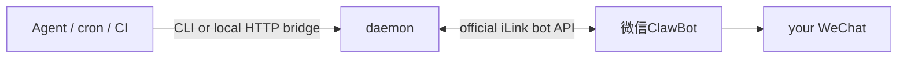

# wechat-clawbot-skill

[](LICENSE)


An agent skill + zero-dependency CLI for **WeChat ClawBot** (微信ClawBot): push text, images and files from your AI agent to **your own WeChat** through Tencent's official iLink bot API. No OpenClaw gateway, no DLL hook, no third-party protocol — pure Python stdlib.

> 中文说明：[README.zh-CN.md](README.zh-CN.md)

## How it works

WeChat 8.0.70+ ships an official plugin「微信ClawBot」that connects a personal WeChat account to a bot gateway. This project implements the gateway side directly (QR login → long-poll → send), so any agent — Claude Code, Codex, OpenClaw, Cursor, cron scripts — can push messages to the bound WeChat account, and read inbound messages back through a spool directory.



## Features

- Send text / image / file (≤20 MB) to your own WeChat; receive via inbox spool
- Official channel: the protocol is the one shipped by Tencent's `@tencent-weixin/openclaw-weixin` plugin
- Zero dependencies: pure Python 3.10+ stdlib; MD5 and AES-128-ECB implemented locally and validated against RFC 1321 / FIPS-197 test vectors
- **24h push-window keeper**: personalized keepalive nudges, failed-send queue with auto-replay and dead-letter, quota warnings
- Inbound loop: `/status` and `/help` built in; every message you send to ClawBot renews the push window
- Optional localhost HTTP bridge (Bearer token) for CI / Home Assistant / cron
- Cross-platform onboarding guides: Linux (systemd user service), macOS (launchd), Windows (Task Scheduler)

## Quick start

Copy `comm-wechat/` into your agent's skill directory (e.g. `~/.agents/skills/`) and let your agent follow the onboarding wizard in `SKILL.md` (QR bind → keepalive service → activation → end-to-end test). Manual path:

```bash
python3 comm-wechat/wechat_clawbot.py login        # scan the QR with WeChat
python3 comm-wechat/wechat_clawbot.py daemon       # keepalive + inbound loop
python3 comm-wechat/wechat_clawbot.py send --text "hello from my agent"
python3 comm-wechat/wechat_clawbot.py send --file report.pdf
```

Send returns `OK -> <userId>`; if the 24h window has lapsed it returns `QUEUED` and auto-replays once you next message ClawBot. See `SKILL.md` for keepalive personalization, the HTTP bridge, troubleshooting and uninstall steps.

## Limitations

These are WeChat platform rules, not implementation gaps:

- Self-chat only — you cannot message friends or groups through ClawBot.
- **24h push window**: WeChat only delivers bot-initiated messages within 24h of your last inbound message. Every client has this; the daemon mitigates it (nudges + queue + replay).
- ~10 proactive messages per 24h (community-observed quota; exact limits unpublished).
- No outbound voice/video (bot API limitation).
- ClawBot is in staged rollout; some accounts don't see the plugin yet.

## Disclaimer

Not affiliated with or endorsed by Tencent. WeChat and ClawBot are trademarks of Tencent. The iLink API is used exactly as the official plugin ships it and may change without notice. Personal use only — no spam, no marketing, no bulk messaging.

## License

[MIT](LICENSE)
