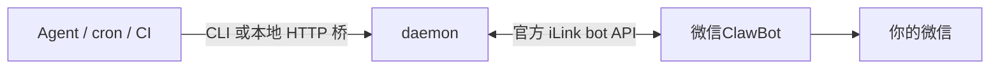

# wechat-clawbot-skill

[](LICENSE)


微信官方 ClawBot 通道的 agent skill + 零依赖 CLI：把文本、图片、文件从你的 AI agent 推送到**你自己的微信**。走腾讯官方 iLink bot API——不装 OpenClaw、不注入 hook、不碰第三方协议，纯 Python 标准库。

English: [README.md](README.md)

## 它是什么

微信 8.0.70+ 内置官方插件「微信ClawBot」，把个人微信连到一个 bot 网关。本项目直接实现网关侧（扫码登录 → 长轮询 → 发送），任何 agent（Claude Code、Codex、OpenClaw、cron 脚本……）都能向绑定的微信推送消息，你在微信里发的消息也会落盘给 agent 读。



## 特性

- 发文本 / 图片 / 文件（≤20MB）给自己的微信；入站消息落盘可反向驱动 agent
- 官方通道：协议与腾讯 `@tencent-weixin/openclaw-weixin` 插件一致，零封号风险
- 零依赖：纯 Python 3.10+ 标准库；MD5 与 AES-128-ECB 本地实现，经 RFC 1321 / FIPS-197 标准向量验证
- **24h 推送窗口看护**：保活提醒可个性化（天气/日报/日程），发送失败自动排队补发（带 dead-letter），配额告警
- 内置 `/status`、`/help` 指令；你发的每条消息都会续期推送窗口
- 可选本地 HTTP 桥（Bearer token），CI / Home Assistant / cron 直接调
- 全平台配置向导：Linux（systemd）、macOS（launchd）、Windows（任务计划）

## 快速开始

把 `comm-wechat/` 目录拷进 agent 的技能目录（如 `~/.agents/skills/`），让 agent 按 `SKILL.md` 的配置向导走（扫码绑定 → 保活服务 → 激活 → 端到端验收）。手动路径：

```bash
python3 comm-wechat/wechat_clawbot.py login        # 微信扫码绑定
python3 comm-wechat/wechat_clawbot.py daemon       # 保活 + 入站闭环
python3 comm-wechat/wechat_clawbot.py send --text "来自 agent 的消息"
python3 comm-wechat/wechat_clawbot.py send --file report.pdf
```

发送返回 `OK -> <userId>`；24h 窗口失效时返回 `QUEUED` 并自动入队，你下次给 ClawBot 发消息后自动补发。保活个性化、HTTP 桥、排障与卸载见 `SKILL.md`。

## 已知限制

以下均为微信平台规则，非实现缺陷：

- 只能发给自己（ClawBot 会话），不能发好友/群聊
- **24h 推送窗口**：超 24 小时没给 ClawBot 发过消息，bot 下发的内容会被微信丢弃（所有客户端皆然，本项目用提醒+队列缓解）
- 主动推送约 10 条/24h（社区观察值，官方未公开口径）
- 不支持主动发语音/视频（bot API 限制）
- ClawBot 插件灰度放量中，部分账号暂无入口

## 免责声明

与腾讯无关联、非官方项目。WeChat 与 ClawBot 是腾讯的商标。iLink API 按官方插件现状使用，可能随官方更新而变化。仅供个人使用——勿用于营销、群发、骚扰。

## 许可证

[MIT](LICENSE)
